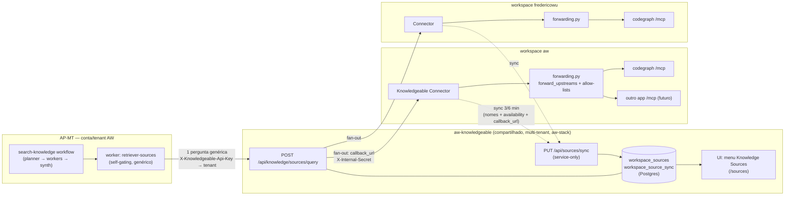
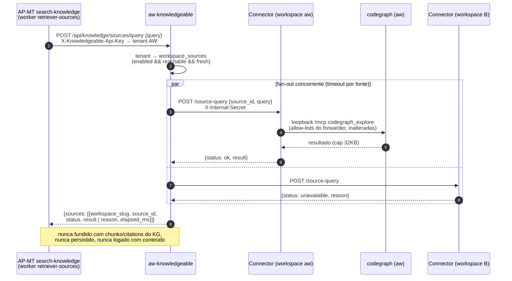

# aw-knowledgeable "Knowledge Sources" — per-workspace source registry, Connector sync, and multi-workspace fan-out

Status: **design + diagrams, for Frederico's review — nothing here is to be
built until he approves and the PO slices cards.** Architect, 2026-10-23,
card `4025bf3b-9510-8137-bec0-f774a26d3868`. Frederico's ask (Telegram,
2026-10-23, PT): a new **"Knowledge Sources" menu** in aw-knowledgeable's UI
showing which knowledge sources each workspace offers, **populated by
automatic sync from each workspace's Knowledgeable Connector** (not manual
registration); and the AP-MT `search-knowledge` workflow should stop saying
"codegraph" and instead send a **generic "external sources" question to
aw-knowledgeable, which resolves it to the right tenant's workspaces and
fans out to their Connectors**.

Builds directly on, and does not reopen:

- `docs/design/knowledgeable-connector-tool-forwarder.md` — the Connector's
  `forward_upstreams` registry, **built and live** (v0.71.0,
  `repos/aw-app-knowledgeable/knowledgeable_app/forwarding.py`). It stays the
  *only* enforcement point for what can be asked of a workspace's sources.
- `docs/design/search-knowledge-codegraph-p6-worker.md` — the P6 worker
  (shipped; its transport is being re-pointed on card `4025bf3b…810e`).
- `docs/design/search-knowledge-entrypoint-migration-scoping.md` + the epic
  `Epic: migrate search-knowledge AP-MT workflow to be the production
  knowledge-retrieval entry point` (`4015bf3b-9510-8185-a084-f6dfcf2c6cf2`)
  — the workflow is becoming the production entry point; this design gives
  its external-sources leg a home that doesn't depend on AP-MT→workspace
  network reachability.
- AP-MT's **WorkspaceSkillSync** (ADR 2026-08-06, "decentralized skills
  index") — the sync pattern copied here, deliberately.

## 0. Actionable summary

1. **aw-knowledgeable gains a `workspace_sources` registry** (two Postgres
   tables beside `tenants`, `backend/app/core/tenant_store.py` precedent):
   one row per `(tenant, workspace_slug, source_id)` — metadata only (app
   slug, tool names, availability, last check), **never content, never
   credentials beyond what §4 states**.
2. **Each Connector syncs its `forward_upstreams` registry up**, in the
   exact WorkspaceSkillSync shape: a new push loop in the Connector's
   existing loop family (delta ~3 min hash-gated + reconcile ~6 min
   unconditional, acked state in the app data dir), to a new service-only
   `PUT /api/sources/sync`. **Exact mirror**: a source absent from the
   payload is deleted — never left behind as a zombie.
3. **New UI menu "Knowledge Sources"** in `frontend-react` (`App.tsx`
   `BASE_NAV` + route `/sources`): the tenant's workspaces, each source's
   availability/staleness/reachability, and one mutable field — a
   server-side `enabled` toggle. Everything else is sync-owned.
4. **New fan-out endpoint `POST /api/knowledge/sources/query`**: AP-MT (or
   any tenant caller) sends one generic question; aw-knowledgeable resolves
   caller → tenant → enabled sources, calls each workspace's Connector
   **callback URL** concurrently (new Connector route `POST /source-query`,
   mirror of the existing `GET /keys/{slot}` reverse channel), and returns
   `{sources: [{workspace_slug, source_id, status, result|reason}]}` —
   **never fused** with KG chunks, never persisted.
5. **AP-MT's code worker generalizes**: `knowledgeable-retriever-code`
   becomes an "external sources" worker bound to a new direct REST tool
   (`knowledge.sources`, clone of the existing `knowledge.search` tool
   shape) — no more hardcoded per-workspace Connector URL, no more
   "codegraph" in the workflow's vocabulary. Tenancy rides the scoped key:
   the AP-MT of the AW account reaches exactly the AW tenant's workspaces.
6. **Deliberately not built now**: per-connector credentials (v1 keeps the
   existing shared-secret trust model — §8 names the trigger), a
   long-poll/relay transport for NAT'd workspaces (§7 names the trigger),
   and any AP-MT-level source auto-registration (stays rejected per the P6
   design §5).

## 1. The decision, in sentences someone can disagree with

The inventory and the routing both live in **aw-knowledgeable**, because it
is the only component every party can already reach: every Connector pushes
to it today (keys, documents, exec history), and AP-MT already calls it
directly over aw-stack with a scoped key — whereas AP-MT provably cannot
reach workspace-internal gateways (memory
`ap-mt-cannot-reach-workspace-mcp-gateway-network`; the current worker only
works because the AW workspace's gateway happens to be co-located on the
aw-stack docker network). The registry is **populated only by Connector
push** — manual registration is rejected outright (Frederico's explicit ask,
and the zombie-upstream lesson: rows no sync owns, rot). The query path is
**aw-knowledgeable dialing back into each workspace's Connector over a
synced callback URL** — the reverse channel that `core/key_pull.py` already
exercises in production, generalized from one scalar URL to a per-workspace
map. The Connector remains the **sole enforcement point**: aw-knowledgeable
never learns which tools exist beyond names, never bypasses the forwarder's
tool/argument allow-lists, and never persists what comes back.

## 2. Ground truth this design stands on (verified this run, 2026-10-23)

1. **The Connector forwarder is live — but only `forward()` is generic.**
   `knowledgeable_app/forwarding.py` reads `forward_upstreams` fresh per
   call (`_registry()`, :67-88), enforces per-tool/per-arg allow-lists in
   `forward()` (:169-215), caps results at 32KB, keeps a per-worker
   availability cache. The registry config comes from the app manifest's
   `config_schema` with the codegraph entry as the shipped default
   (`aw-app.json:234-275`). **However** `compose_knowledge_search`
   (:242-299) hardcodes `forward("codegraph", "codegraph_explore", …)` at
   :271 and :285 — "upstream #2 = one config entry" is true of `forward()`
   but false of the `knowledge_search` composition today.
2. **aw-knowledgeable has no per-connector identity.** `resolve_tenant_id`
   (`backend/app/core/identity.py:299-329`) has three branches: the ONE
   global `X-Internal-Secret` → the ONE declared
   `KNOWLEDGEABLE_SERVICE_TENANT_ID`; owner subs → same tenant; other JWT
   subs → minted tenant (`core/tenant_store.py:63-89`). Every Connector in
   the estate presenting the secret lands in the same tenant;
   `workspace_slug` is **self-asserted per request** (exactly how fs-sync
   document pushes work today, `backend/app/api/documents.py:254-358`).
3. **The reverse channel exists and is production-exercised**:
   `backend/app/core/key_pull.py:44-72` GETs the Connector's
   `/keys/{slot}` route with the same shared secret outbound; the Connector
   route re-verifies the secret itself
   (`knowledgeable_app/routes.py:244-260`). But the address is one scalar
   setting (`knowledgeable_key_source_url`, `config.py:61`) — there is **no
   per-workspace URL map anywhere**, no `(:Workspace)` node, no connectors
   table (explored exhaustively this run).
4. **WorkspaceSkillSync is the house pattern for exactly this problem** —
   a decentralized, names-only, per-workspace index: AP-MT's
   `workspace_skills` + `workspace_skill_sync` tables
   (`agents-platform-multitenant/backend/app/models.py:2164-2213`, unique on
   `(tenant_id, workspace, slug)`, hard-delete on disappearance), fed by
   `POST /api/runners/skills/sync` (`backend/app/api/runners.py:289`), pushed
   from each workspace by
   `aw-app-agents-platform-runners/agents_platform_runners_app/skills_sync.py`
   (delta ~3 min hash-gated, reconcile ~6 min unconditional, acked
   state on disk). Content never leaves the workspace; names do.
5. **AP-MT already has the direct REST tool shape**:
   `agents-platform-multitenant/backend/app/core/tools/knowledgeable.py`
   POSTs `/api/knowledge/search` over aw-stack with
   `X-Knowledgeable-Api-Key` (scoped read key,
   `identity.py::verify_scoped_read_key:214-227`), registered via
   `integration_tools()` on exact `tool_specs` match only.
6. **The workflow's 4 workers are not workspace-scoped** (repoint card
   `4025bf3b…810e`: `workspace: null` on all four, Connector URL hardcoded
   in `mcp_config`) — the gap Frederico explicitly wants closed: *"o ap-mt
   da conta da workspace AW, vai apontar pra workspace AW"*.
7. **The P6 code worker has never actually worked** (verified live this
   run): `knowledgeable-retriever-code` carries
   `tool_specs: ["knowledge.search"]`, whose `StructuredTool` signature
   (`core/tools/knowledgeable.py:21-28`) has **no**
   `include_code`/`code_only`/`code_query` — the very arguments its prompt
   instructs it to pass — and the `knowledgeable-ws` McpServer row it was
   designed to use has `discovered_tools: []`, `last_refreshed: null`
   (Discover was never run). All three live `retrieve-code` runs emitted
   `CODE PERSPECTIVE SKIPPED`, including on a textbook code question. The
   code perspective has never once reached codegraph through AP-MT. This
   design (with the in-flight repoint card as the tactical bridge) is the
   fix, not a risk to a working path.
8. **The workflow and its agents are live DB rows only** — not seeded, not
   in any repo (`seed.py:176-215` has only demo workflows; card
   `4005bf3b…813c` tracks the no-seed gap). Edits happen via
   `update_workflow`/`update_agent`, nothing else. The only "codegraph"
   literals to remove live in those rows (worker label "Retrieve (code
   reality)", agent prompt ¶2's "the codegraph leg…") and in the
   Connector's tool schema descriptions (`mcp/client.py:1571-1617`) — the
   AP-MT repo itself contains zero occurrences of the string.
9. **`AGENTS_KNOWLEDGEABLE_BASE_URL` / `AGENTS_KNOWLEDGEABLE_API_KEY` are
   configured in no repo** (not AP-MT compose, not aw-stack) — live and
   working, set out-of-band on the host. Any new sibling setting inherits
   this gap; named so C4 documents where they actually live.
10. **Frontend seams**: nav + routes are one file
   (`frontend-react/src/App.tsx` — `BASE_NAV` :18-23, routes :151-162);
   page shell `src/components/Page.tsx`; typed client `src/lib/api.ts`;
   the only gated-surface precedent is `ExecGate` (`App.tsx:32-41`) backed
   by `require_exec_viewer` (fail-closed probe). There is no existing
   admin/settings page — Knowledge Sources will be the first.
11. The live workflow/agent rows were read this run via AP-MT's REST API
   (an explorer agent; the gateway's `agents-platform-runners` MCP upstream
   timed out three times) — the graph: planner `knowledgeable-search-planner`
   → workers `retrieve-vector/lexical/graph/code` (identical
   `input_template`s) → synthesizer `knowledgeable-playground`, workflow
   `description` naming "code-reality" explicitly.

## 3. The architecture, in one picture

And the query flow Frederico asked to see — AP-MT asks, aw-knowledgeable
resolves:

## 4. Where it lands — files and seams

### 4a. aw-knowledgeable (repos/aw-knowledgeable — **auto-ships on push to master**, deploy with care)

- **Registry tables** — new module `backend/app/core/source_store.py`,
  SQLAlchemy Core beside `tenant_store.py` (same lazy-engine +
  `metadata.create_all` idiom; there is no Alembic in this repo):
  - `workspace_sources(tenant_id, workspace_slug, source_id, app_slug,
    tool_names JSON, available BOOL, reason TEXT, checked_at, enabled BOOL
    DEFAULT true, updated_at)` — unique `(tenant_id, workspace_slug,
    source_id)`, mirroring `workspace_skills`' tenant-scoped uniqueness
    (that PK famously shipped without `tenant_id` once — AP-MT Kanban
    `ap-mt:workspace-skill-sync-pk-missing-tenant-id` — don't repeat it).
  - `workspace_source_sync(tenant_id, workspace_slug, callback_url,
    reachable BOOL, reachable_reason, state_hash, connector_version,
    last_full_at, last_delta_at)` — **composite PK `(tenant_id,
    workspace_slug)`**, copied verbatim from AP-MT's `WorkspaceSkillSync`
    (`models.py:2220`), whose original workspace-only PK caused live 500s
    when a second tenant reused the workspace name `aw`. Copy, don't
    re-derive.
  - Postgres, not Neo4j, deliberately: rows carry URLs and operational
    state, not knowledge; the KG's composite-key conventions
    (`graph.py:296-301`) forbid widening, and `tenants` already set the
    identity-adjacent precedent.
- **Sync endpoint** — new router `backend/app/api/sources.py`, mounted in
  `api/__init__.py` under the existing `require_tenant_or_service`
  umbrella:
  - `PUT /api/sources/sync` — **service-only inside the handler**
    (`identity.user_id != SERVICE_USER_ID → 403`, the exact fs-sync
    pattern, `documents.py:258` area). Body and semantics copy the
    WorkspaceSkillSync wire contract (`api/runners.py:289-390`):
    `{workspace_slug, callback_url, connector_version, mode: full|delta,
    prev_hash, state_hash, sources: [{id, app_slug, tool_names, available,
    reason, checked_at}]}` — full mode upserts all + hard-deletes the
    absent (**exact mirror**); delta mode checks `prev_hash` against the
    stored hash and answers `409 {"error": "hash_mismatch"}` on drift; the
    server **always recomputes** the authoritative hash from the resulting
    rows (the client hash is a drift detector, never truth). `enabled`
    survives upserts (operator-owned). On accept, probe `callback_url`
    once (5s, no redirects) and record `reachable/reachable_reason`.
  - `GET /api/sources` — tenant-scoped list for the UI (and for curious
    agents).
  - `PATCH /api/sources/{workspace_slug}/{source_id}` `{enabled}` —
    owner-gated (reuse the `require_exec_viewer` owner-sub shape, or a
    sibling `require_sources_admin`; fail-closed probe for the UI).
- **Fan-out endpoint** — `POST /api/knowledge/sources/query` in the same
  router (NOT inside `core/knowledge_search.py` — that pipeline's scope
  contract says a permission boundary must never become a model decision,
  `knowledge_search.py:80-86`; this is a new layer above it, not a fourth
  retrieval arm):
  - Auth: `require_tenant_or_service` — accepts the service secret AND the
    scoped read key (`ScopedServiceIdentity`); **verify the scoped key
    resolves through `resolve_tenant_id` to the declared tenant** — if the
    scoped-key branch doesn't, that's a small identity.py extension, named
    here so it's costed.
  - Body: `{query, code_query?, workspace_slugs?, source_ids?,
    budget_ms? (default 15000, clamp 20000)}`.
  - Resolution: tenant → rows where `enabled && reachable`, optionally
    narrowed by the body filters. Zero rows → `{sources: []}` with a
    `reason: "no enabled sources"` — never an error.
  - Fan-out: `asyncio.gather` with a small concurrency cap (8) and
    per-source timeout `min(10s, budget)` — production is deliberately
    **single-worker** (`aw-knowledgeable-production-must-stay-single-worker`);
    the fan-out is pure async I/O, but the cap keeps one bad query from
    monopolizing the event loop's connection pool.
  - Per source: `POST {callback_url}/source-query` with
    `X-Internal-Secret` (the same header `key_pull.py:54` already sends
    outbound), body `{source_id, query, code_query?}`. Response passes
    through **verbatim, bounded** (the Connector already caps at 32KB).
    Failure → `{status: "unavailable", reason}` for that source; the
    envelope is never a 500.
  - **Nothing is persisted or content-logged.** Audit log line per
    fan-out: tenant, workspace, source, status, elapsed — no query text,
    no result text (the exec-scrub lesson: this service's logs feed
    nothing that should see workspace code).
- **Boot validator** — `config.py:388-451`'s family gains nothing in v1
  (no new credential class); noted because §8's per-connector follow-up
  will need it.

### 4b. Knowledgeable Connector (repos/aw-app-knowledgeable — Tier-1; release bot owns the version; core restart scheduled deliberately)

- **`knowledgeable_app/sources_sync.py` (new)** — the WorkspaceSkillSync
  twin, pointed at **aw-knowledgeable** (which the Connector already
  authenticates to — unlike AP-MT, for which it holds no token; §6.3):
  reads `forwarding._registry()` + `status_block()` (names, availability),
  computes the state hash (byte-identical function both sides, the
  `skills_sync.py:76-81` rule), pushes `full` or `delta`. Cadences copied
  from `agents_platform_runners_app/plugin.py:533-592`: delta ~180s
  (`run_immediately=True` → boot tick full-syncs), reconcile ~360s
  unconditional; acked state in an atomic JSON file under the app data dir
  (`_clear_ack()` on 409/failure → next tick full-syncs); the secret
  re-read **every tick**, never captured at `activate()` (the "23
  consecutive 401s forever" lesson). `workspace_slug` and `callback_url`
  come from app config (`aw-app.json` gains `source_callback_url`; empty =
  sync still runs, row lands `reachable=false, reason="no callback_url
  configured"` — visible, not silent).
- **`knowledgeable_app/routes.py`** — new `POST /source-query`, the mirror
  image of `GET /keys/{slot}` (:244-260): **verifies `X-Internal-Secret`
  itself** with `hmac.compare_digest`, never trusts the workspace wrapper;
  resolves the source via `forwarding._find_upstream`, calls
  `forwarding.forward(upstream_id, query_tool, {query…})` — every
  allow-list, timeout, cap and probe-cache behavior **unchanged**.
  aw-knowledgeable gets exactly what a local `include_code` caller gets.
- **`forwarding.py` — one small edit**: registry entries gain an optional
  `query_tool: {tool, arg}` field naming which allow-listed tool answers a
  generic natural-language query, and with which argument (the shipped
  codegraph default: `{tool: "codegraph_explore", arg: "query"}`).
  Necessary because `compose_knowledge_search` hardcodes
  `("codegraph", "codegraph_explore")` at :271/:285 — the registry is
  generic, the composition is not. Generalizing `compose_knowledge_search`
  itself (`include_code` → a per-source `include_sources` list for
  workspace-local callers) is **optional and deferred**: it would add a
  fourth response shape to `knowledge_search` (forwarder doc §12 already
  counts three) and no workspace-local caller has asked for source #2 yet.
  `/source-query` + `query_tool` is the minimal generic surface the
  fan-out needs.

### 4c. aw-knowledgeable UI (frontend-react)

- `App.tsx`: `BASE_NAV` entry `{to: "/sources", label: "Knowledge
  Sources"}` + `<Route path="/sources" element={<Sources/>}/>`.
- `src/routes/Sources.tsx` (new, `Page.tsx` shell; `Dashboard.tsx` is the
  visual exemplar): grouped by workspace — source id, app, tool names,
  availability chip (`ok / unavailable: reason`), callback reachability,
  `last_synced_at` with a **stale** state (> 2× reconcile interval ≈ 12
  min), and the `enabled` toggle (rendered read-only unless the admin
  probe passes — the `ExecGate` fail-closed pattern, applied to the
  action, not the page).
- `src/lib/api.ts`: `listSources()`, `setSourceEnabled()`, admin probe.

### 4d. AP-MT (repos/agents-platform-multitenant) + workflow objects (data)

- **New tool** `knowledge.sources` in
  `backend/app/core/tools/knowledgeable.py::integration_tools()` — clone
  of `_knowledge_search_tool`'s shape, POSTing
  `/api/knowledge/sources/query` with the same
  `settings.knowledgeable_base_url` + `X-Knowledgeable-Api-Key`. Returns
  the raw JSON envelope.
- **Agent**: `knowledgeable-retriever-code` → generalized (rename to
  `knowledgeable-retriever-sources` or re-prompt in place — PO/Coder
  call). Prompt contract: self-gate stays ("is this answerable by the
  workspace's live external sources — code structure, where-is-X,
  what-calls-Y, or any source the tool result lists?"), the word
  **codegraph disappears**, one tool call
  (`knowledge.sources {query, code_query}`), raw JSON verbatim back, skip
  sentence (`EXTERNAL SOURCES SKIPPED: <reason>`) preserved so the frozen
  synthesizer needs no change.
- **Workflow**: `update_workflow(search-knowledge)` — worker label becomes
  "Retrieve (external sources)"; the `description`'s "code-reality"
  vocabulary and fidelity paragraph updated. Remember: workflow and agents
  are **live DB rows with no seed** (card `4005bf3b…813c`) — these edits
  exist only as API calls, and the competing DAG-rewrite design
  (`docs/design/ap-mt-workflow-dag-transform-nodes.md` §4a) touches the
  same two rows; whoever implements first, the other rebases.
  When the migration epic's forked planner (`sk-planner`) lands, the
  routing block it emits (`{code: {answerable, code_query}}` per the
  scoping doc §2) generalizes to per-source flags — the worker's prompt
  gains the "obey the PLAN's flag when present" line, exactly the handover
  already designed there.
- **Tenancy**: the scoped key *is* the tenant selector — AP-MT holds one
  key per account/tenant (today: one, the AW account, →
  `KNOWLEDGEABLE_SERVICE_TENANT_ID`). No workspace URL, no gateway token,
  no `mcp_config` server row remains on the worker. *"O ap-mt da conta da
  workspace AW aponta pra workspace AW"* becomes a property of the
  registry, not of agent config.

### 4e. Relation to the in-progress repoint card (`4025bf3b…810e`)

That card re-points the current worker at the AW workspace's co-located
gateway path — the tactical fix that keeps P6 working **today**. It
proceeds unchanged. This design's §4d supersedes its transport when C4
ships (worker stops holding any per-workspace URL at all); the repoint
card's own body already says multi-tenant routing is out of its scope and
points here.

## 5. Sequencing (cards for the PO to slice — each independently shippable)

- **C1 — aw-knowledgeable registry + sync + fan-out** (§4a). Ships first:
  endpoints must exist before any pusher. Includes the callback probe and
  the scoped-key acceptance check.
- **C2 — Connector sync loop + `/source-query` route** (§4b). The push
  loop tolerates 404s until C1 deploys (the key-push loops already set the
  precedent). First real row appears; verify with the live-measurement
  harness (`aw-autoskill-aw-knowledgeable-live-measurement-harness`).
- **C3 — UI menu** (§4c). Needs only C1.
- **C4 — AP-MT tool + worker generalization + workflow update** (§4d).
  Needs C1+C2 live; supersedes the repoint card's transport.
- Deploy realities: aw-knowledgeable auto-ships on push to master
  (`knowledgeable-repos-auto-ship-on-push-to-master`); the Connector is
  Tier-1 (release-bot version bump + deliberate core restart, never from
  inside the implementing run).

## 6. What I rejected, and why it stays rejected

1. **Manual registration UI** — Frederico's ask is sync-populated, and the
   estate's own history says why: rows no reconciler owns become zombie
   sources (the gateway's documented failure mode). The UI's only write is
   `enabled`.
2. **AP-MT-level auto-registration pipeline** ("apps contribute sources →
   McpServer rows appear") — rejected in the P6 design §5 and *more*
   rejected now: AP-MT cannot even reach workspace gateways
   (`ap-mt-cannot-reach-workspace-mcp-gateway-network`), `McpServer` is
   tenant-wide with no `workspace` column (`models.py:1200-1221`), and
   Frederico's chosen shape routes through aw-knowledgeable. To be precise
   about the P6 doc's own revival test (§5, clause c — "source lifecycle
   must be reconciled or rows serve zombie tools"): **that condition is now
   real, and this design satisfies it one level down** — the exact-mirror
   Connector sync *is* the lifecycle reconciler, landing in
   aw-knowledgeable instead of AP-MT. The P6 rejection of the AP-MT-level
   variant stands unmodified.
3. **Sync the inventory into AP-MT via the runners app** (the literal
   WorkspaceSkillSync copy — the runners app holds the AP-MT identity JWT
   and the 180/360s watchdog; the Connector holds no AP-MT credential) —
   coherent, and the right answer *if* the inventory's consumer were
   AP-MT. It isn't: AP-MT can't reach workspaces, so an inventory there is
   a map of places it cannot call. The consumer of both the inventory and
   the routing is aw-knowledgeable; the Connector already authenticates to
   it. The *pattern* is copied; the destination is not.
4. **aw-knowledgeable → workspace gateway directly** (skip the Connector
   route) — would need a gateway client token per workspace and inherits
   the HTTP-upstream zombie-caching exactly where ground truth is needed;
   the Connector's own route + its allow-lists is the fence the forwarder
   design already built. Same verdict as that doc's §4, new caller.
5. **A fourth retrieval arm / `mode: "sources"` on `knowledge_search`** —
   the scope contract (`knowledge_search.py:80-86`) and the P6 no-fusion
   semantics both forbid it; external results are a sibling section, never
   ranked against KG chunks. Also keeps the migration epic's "primitive =
   retrieval only" demotion clean.
6. **Long-poll / relay reverse transport** (Connector polls for pending
   queries; works behind NAT) — runner-up, and the eventual answer for a
   workspace with no inbound path. Rejected for v1: it adds a pending-query
   queue + poll latency to a **single-worker** production service, for a
   customer that doesn't exist yet — both live workspaces (aw,
   fredericowu) have reachable edges, and `key_pull`'s fallback analysis
   already blessed the public edge URL for sub-second calls. **Trigger to
   build it**: a synced workspace whose callback probe fails and whose
   sources matter. The registry's `reachable=false` rows are the visible
   backlog for exactly that.
7. **Per-connector credentials in v1** — see §8. Minting a credential
   dimension now, with one tenant and two workspaces sharing one secret
   everywhere (push, pull, fs-sync, exec-history), would be a fifth
   rotation surface guarding against a party that already has full
   document-write trust. Named follow-up with a hard trigger, not built.
8. **Storing the registry in Neo4j** — URLs and operational state aren't
   knowledge; `(:Document)`'s composite-key rules forbid widening; the
   Postgres `tenants` table is the identity-adjacent precedent. (Agent-
   explored both options this run; Postgres wins on every axis but "free
   tenant_ctx isolation", which `WHERE tenant_id = :t` replaces.)

## 7. What this makes harder later

- **aw-knowledgeable becomes an active caller into N workspaces.** Its
  failure surface was "is Postgres/Neo4j up"; now it includes every
  registered callback. Bounded (per-source timeout, concurrency cap,
  never-500 envelope), but incidents gain a new shape: "tenant's search
  slow because workspace B's edge is flapping". The per-source
  `elapsed_ms` in the envelope is the observability hook.
- **Workspace code excerpts now transit the shared multi-tenant service.**
  The forwarder design §8 could say "nothing from codegraph ever enters
  the multi-tenant KG service"; after this, results pass **through** it
  (in-flight only — never persisted, fused, or content-logged). That's a
  real widening, accepted deliberately because AP-MT→workspace has no
  network path and Frederico wants central routing. The §4a no-persist/
  no-log rules are load-bearing, not hygiene.
- **`callback_url` is connector-supplied** — an SSRF-shaped field on a
  server that will dutifully POST to it. v1 mitigation: scheme allow-list
  (https + http-on-private-ranges for co-located deployments), no
  redirects, 5s probe, and the caller holds the same secret that could
  already push arbitrary documents — same trust party. A per-deployment
  URL-prefix allowlist is the cheap hardening if this ever itches.
- **Two paths to the same codegraph coexist**: workspace-local callers
  keep `knowledge_search(include_code=true)` (Connector-side composition);
  AP-MT and the UI go through the fan-out. Both funnel through
  `forwarding.forward()` — one enforcement core — but doc readers will ask
  "which path produced this?"; the envelope's `source`/`workspace_slug`
  fields answer it.
- **Exact-mirror sync can empty a workspace's sources** on a Connector
  config regression (empty `forward_upstreams` → all rows deleted next
  push). Mitigation is visibility, not prevention: the UI's per-workspace
  "0 sources, last sync 2 min ago" state + `state_hash` history in the
  sync row. Same trade WorkspaceSkillSync made, same reason.

## 8. The tenancy gap, named precisely (for the PO)

Today **one global secret → one tenant**, and `workspace_slug` is
self-asserted under it — for sources exactly as for fs-sync documents. A
compromised Connector can therefore impersonate a *sibling workspace of the
same tenant* (overwrite its sources, as it could already overwrite its
documents). It can never cross tenants — other tenants exist only via JWT
subs. **v1 accepts this consciously** (no new risk class). **Hard trigger
for per-connector credentials** (a `connectors` table, per-workspace
enrollment, boot validators extended per `config.py:388-451`): the first
Connector belonging to a *second real tenant* — at that moment the shared
secret would collapse tenants, which `resolve_tenant_id` cannot allow. That
work is an epic-sized identity change and must be PO-scoped; this design
keeps its surface small (one table + one header swap) by funneling all
reverse calls through `/source-query`.

## 9. Risks for the Coders — the non-obvious breakage

1. **Optional-config paths ship untested** (the estate's recorded
   pattern). Mandatory tests per card: sync with empty registry (deletes
   all, visibly); sync with unchanged hash (no-op); fan-out with zero
   enabled sources; fan-out with one source down (envelope, not 500);
   `enabled=false` actually excluded; callback probe failure →
   `reachable=false` row, sync still accepted.
2. **Async or nothing**, both sides: the Connector route calls
   `forwarding.forward()` (already async httpx); the fan-out is
   `asyncio.gather` on a single-worker service — one sync HTTP client
   anywhere on the path stalls production search for everyone.
3. **Never gate on presence** — reachability is a real POST probe, source
   availability is the forwarder's real `tools/call` probe cache. A synced
   row is not a live source; the UI must render the difference.
4. **The Connector settings route clobbers `service_secret`**
   (`knowledgeable-connector-settings-route-clobbers-service-secret`) —
   C2 adds `source_callback_url` to app config; whoever touches the
   settings panel must not re-trip that bug.
5. **Scoped-key scope**: the existing `awsk_` read key was minted for
   `/api/knowledge/search`; confirm `verify_scoped_read_key` admits the
   new route (and that the vault scrub-coverage card
   `4025bf3b…811d` for that key lands — the key now guards a wider door).
6. **Deploy order is C1→C2→C4** and aw-knowledgeable auto-ships on master
   push; the Connector needs a release-bot bump + deliberate core restart.
   Verify each hop live (`exec` into the real container) before the next —
   green CI proves nothing here (`aw-autoskill-verify-deploy-in-container`).
7. **fredericowu's workspace is ~290 commits behind core** (memory,
   2026-10-04): its Connector may predate `forwarding.py` entirely. The
   design degrades correctly (no sync → no rows → not routed), but don't
   let QA interpret "fredericowu absent from the registry" as a bug; it's
   the honest state until that workspace updates.
8. **The `query_tool` registry change must not disturb the composer's
   back-compat suite** — `tests/test_forwarding.py` (27 tests) pins
   byte-identical legacy responses and the `code_only` contract; the new
   field is additive and ignored by `compose_knowledge_search`. While in
   `aw-app.json`, note the pre-existing drift: `contributes.mcp.provides`
   is missing `knowledge_search` and three other dispatched tools — fix on
   its own card, not silently inside this one.
9. **Baseline for C4 QA**: the current `retrieve-code` worker has *never*
   produced a code answer (§2.7) — acceptance is "external sources answer
   appears for a code-shaped question", not "no regression vs today".

## 10. Deliverable status

This document + the two Mermaid diagrams (§3) + the presentation attached
to the card are the entire deliverable. **No implementation is started**,
per the card. Next step after Frederico's review: PO slices C1–C4 (§5),
with §8 flagged as the one decision that may deserve its own epic.
